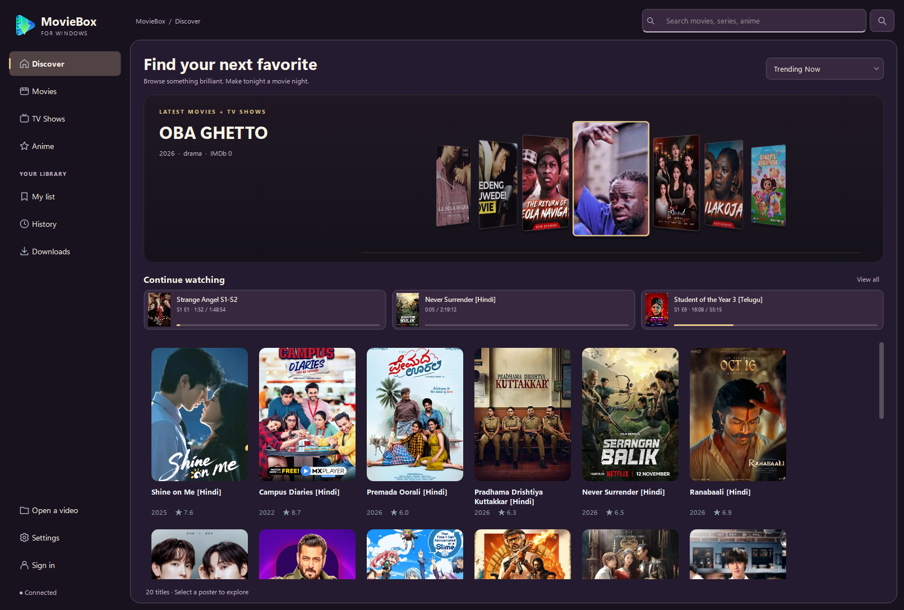

# MovieBox Desktop App

**A native Windows client for browsing, playback, subtitles and your saved library.**

[](https://github.com/emransm877/moviebox-desktop/actions/workflows/ci.yml)
[](https://github.com/emransm877/moviebox-desktop/releases/latest)

[Project website & download insights](https://emransm877.github.io/moviebox-projects/) · [Troubleshooting](docs/TROUBLESHOOTING.md) · [Report a bug](https://github.com/emransm877/moviebox-desktop/issues/new/choose)

[Code signing policy](docs/CODE_SIGNING.md) · [Privacy and network behavior](docs/PRIVACY.md)

An independent preview built with Python and native Qt video playback. It runs
without Android, an emulator or an embedded MovieBox website. The installed app
and shortcuts are named **MovieBox**.



*Actual application capture from the installed 0.10.4 build. Catalogue content and
artwork depend on the upstream service; they are not project-owned assets.*

## Download MovieBox 0.10.4

| Choose a download | Version | How to use it |
| --- | --- | --- |
| [Windows setup EXE](https://github.com/emransm877/moviebox-desktop/releases/download/v0.10.4/MovieBox-Setup-0.10.4-windows-x64.exe) | 0.10.4 | Recommended: run the installer; Python and administrator access are not required. |
| [Portable ZIP](https://github.com/emransm877/moviebox-desktop/releases/download/v0.10.4/MovieBox-Desktop-0.10.4-windows-x64.zip) | 0.10.4 | Extract everything and open `MovieBox/MovieBox.exe`. Keep `_internal` beside the EXE. |

[Release notes and checksums](https://github.com/emransm877/moviebox-desktop/releases/tag/v0.10.4) ? [Windows signing details](docs/CODE_SIGNING.md)

This version adds 20 selectable themes with animated poster layouts, a consistent
left sidebar, compact Continue watching cards and visual settings. Each poster
opens its own title details. Playback, subtitles, My list, history management and
optional update reminders remain available.

## Compatibility and installation

- Windows 10 version 1809 or newer on x64-compatible systems. Native playback has
  been exercised on Windows 11 x64; Windows 10 and ARM emulation are not separately certified.
- This repository's downloads are not macOS, Linux or 32-bit Windows applications.
- Compare your download with its release SHA-256 file. Publisher-signature
  details and Windows trust limits are documented in the [signing policy](docs/CODE_SIGNING.md).
- The app contacts the upstream service for catalogue and playback. A working
  connection and a playable source are required; availability varies by title.

Optional installer shortcuts appear in Start and on the Desktop. To uninstall,
use Windows Settings. Your local library is stored separately in
`%LOCALAPPDATA%\MovieBoxDesktop`; downloads go where you choose.

## What is included

- Native playback, fullscreen, click-to-seek, keyboard controls and available qualities.
- Separate Movies/TV Shows catalogues, search suggestions and combined filters.
- Embedded audio tracks and available dubbed editions; switches preserve progress
  and paused state only between compatible cuts.
- Automatic subtitle discovery/cache, local SRT/WebVTT import and timing adjustment.
- My list, per-episode resume, next-episode playback and background downloads.
- Twenty persistent themes, animated poster layouts, light/dark/system appearance and themed branding.
- A consistent sidebar, compact Continue watching cards and visual theme selection.
- Cached catalogue pages, bulk Continue watching removal and undo.
- Optional GitHub update reminders with Later, Skip and an opt-out. Updates are not forced or automatically installed.

Local library saves use atomic snapshots, recovery copies and merging between app
instances. These safeguards reduce data-loss risks; keep a backup before troubleshooting.

## Known limits

This is an independent preview, not complete Android feature parity. Upstream
access restrictions remain in place. Not every title offers every subtitle,
language or quality. A provider's 1080 label does not guarantee 1080 vertical
picture pixels in widescreen sources.

Native QR ticket creation is verified; user-confirmed account login and Android
history sync are not yet verified. Sessions are protected with Windows DPAPI.
Your phone's app data and this local Windows library are separate.

For freezes, missing progress, installation trouble or playback errors, start with
[troubleshooting](docs/TROUBLESHOOTING.md). Report the exact downloaded release,
Windows version and installer/ZIP; do not attach account data or signed stream URLs.

## Run or build from source

Use Python 3.12 on Windows:

```powershell
python -m venv .venv
.\.venv\Scripts\python.exe -m pip install -r requirements.txt
.\.venv\Scripts\python.exe main.py
.\.venv\Scripts\python.exe -m unittest discover -p "test_*.py"
.\.venv\Scripts\python.exe tools/check_release.py
```

`build.ps1` builds the native executable. `build-installer.ps1` builds the setup
EXE with Inno Setup 7. CI runs offline checks and builds artifacts; it does not
publish releases. See the [release checklist](docs/RELEASE_PROCESS.md) for package,
upgrade and real-playback acceptance. Green unit tests are not certification of
all devices, live sources or network conditions.

## Website, analytics and contributing

The [project website](https://emransm877.github.io/moviebox-projects/) introduces
both Windows and Android projects and combines their download counters. It
separates application packages from checksum files and counts from unique users.
Daily growth starts with recorded observations; earlier daily history cannot be
reconstructed. [Collection rules and local preview](docs/ANALYTICS.md).

Useful contributions include reproducible bug reports, supported-device test
results, documentation and focused fixes. See [CONTRIBUTING.md](CONTRIBUTING.md),
[SECURITY.md](SECURITY.md) and [the Android patch project](https://github.com/emransm877/moviebox-android).

## Independence and licensing

Maintained by [Emran Hossain](https://github.com/emransm877). Not affiliated with
MovieBox, Microsoft or Google. MIT covers independently authored project code;
names, logos, upstream applications, catalogue artwork and dependencies retain
their owners' rights. See [LICENSE](LICENSE) and [third-party notices](THIRD_PARTY_NOTICES.txt).


## Other MovieBox platforms

[Android phone patch](https://github.com/emransm877/moviebox-android) · [Samsung Tizen TV app](https://github.com/emransm877/moviebox-tizen) · [Android TV / Google TV app](https://github.com/emransm877/moviebox-android-tv)

Choose the package for your operating system. These are separate independent
projects; an APK, Windows EXE and Samsung WGT are not interchangeable.
